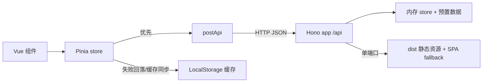

## 产品概述

将「小晶推送馆」的数据存储从浏览器 LocalStorage 改为 Hono + RESTful API + 内存存储的后端服务，前端通过 HTTP 读写数据；LocalStorage 降级为后端不可用时的离线缓存。服务端采用测试先行（TDD）实现，最终由 Hono 单端口同时提供 API 与前端构建产物。

## 核心功能

- **RESTful 数据接口**：提供推送列表查询、新建、修改、点赞状态变更、删除；返回统一的 JSON 结构与中文错误提示，参数非法或资源不存在时给出明确状态码。
- **内存存储**：服务端进程内保存推送数据，启动时预置 2-3 条示例推送，重启后数据清空；`likes` 与 `liked` 均由服务端统一维护，多个浏览器看到一致状态。
- **前端双通道读写**：页面加载与增删改点赞优先请求后端，成功后同步刷新本地缓存；后端不可用（网络失败或 5xx）时自动回落到本地缓存继续可用，并在页面提示当前处于离线缓存模式。
- **单端口部署与访问**：构建后由后端直接托管前端页面与静态资源，刷新任意前端路由都能回到应用页面，访问一个地址即可完成全部操作。
- **交互行为保持**：今日热搜联动预填、表单三段校验与提示、搜索防抖与命中计数、编辑回填与取消、点赞切换与计数展示、删除二次确认、空态与加载态均保持原有体验。
- **可验证性**：服务端与前端均有自动化测试覆盖，另可通过浏览器完成发布、搜索、编辑、点赞、删除、刷新保持、以及后端不可用时的降级验证。

## 技术栈

- 运行时：Node.js v26（fnm 安装于 `C:\Users\86195\AppData\Roaming\fnm\node-versions\v26.13.0\installation`，当前不在 PATH，执行前需临时加入）
- 后端：Hono 4.x + `@hono/node-server`（`serveStatic` 托管 `dist/`）
- 前端：沿用 Vue 3.5 + Pinia 4 + Vite 8（JavaScript，`type: module`）
- 测试：保持 Vitest 5 + `@vue/test-utils` + jsdom；服务端用例使用 `// @vitest-environment node` + `app.request()`，不监听真实端口
- 存储：进程内 `Map`（无文件、无数据库）

## 实现策略

1. **契约先行**：先定义 `GET /api/posts`、`POST /api/posts`、`PUT /api/posts/:id`、`PUT /api/posts/:id/like`（幂等，body `{ liked }`）、`DELETE /api/posts/:id`，成功用 `{ posts }` / `{ post }` 包裹，失败统一 `{ message }` + 400/404 状态码；点赞不用 toggle 语义，避免并发重复点击导致计数漂移。
2. **校验与归一化复用**：把 `TITLE_MAX`/`BODY_MAX`/`validatePostInput`/`normalizePosts` 上移到根级 `shared/postSchema.js`，服务端与前端 store 共用，消除两份校验文案漂移；`src/services/postStorage.js` 改为从 `shared` 再导出，保证现有 `postStorage.spec.js` 与组件 import 不受影响（兼容性优先）。
3. **服务端分层**：`server/store.js`（纯内存仓储，注入 `now` 以便确定性测试）+ `server/app.js`（`createApp({ store })`，只挂 `/api/*`，可被 `app.request()` 直接测试）+ `server/index.js`（读取 `PORT`，挂载 API、静态资源与 SPA fallback，启动日志一行）。`dist/index.html` 不存在时返回可读提示而非崩溃。
4. **前端网络层**：新增 `src/services/postApi.js`，`createPostsApi({ fetchImpl, baseUrl = '/api' })` 把 HTTP 细节、JSON 解析、错误映射收敛在此；统一抛 `ApiError{ message, status }`，`status = 0` 表示网络不可达，`status >= 500` 也按不可用处理。store 通过可注入的 `api` 依赖获得该对象，测试注入假实现，不 mock 全局 `fetch`。
5. **store 异步化 + 双通道**：`posts.js` 保留现有 getters/搜索/编辑态逻辑，动作改为返回 `Promise<{ ok, message }>`：

- `load()`：先 GET，成功则归一化落库并写缓存、`apiAvailable = true`；失败则 `readPosts()` 读缓存、`apiAvailable = false`、给出离线提示（此路径不写缓存，避免空数据覆盖）。
- `publish/updateEditing/toggleLike/remove`：先校验，再请求；成功用服务端返回的 post 覆盖本地并写缓存；网络类失败则本地变更 + 写缓存 + 标记离线并返回本地成功文案；`404` 更新返回「该推送已不存在」并退出编辑态，删除视为已删除继续本地移除。
- 语义明确：恢复在线后 `GET` 结果为准，离线期间的本地改动不自动回传（无队列、无冲突合并），文档中说明该取舍。

6. **性能**：内存仓储单条操作为 O(1)，列表返回 O(n log n) 排序（n 为页面规模，可忽略）；搜索仍在前端完成，不产生额外请求；服务端每个请求最多一次 `JSON.parse`，无 N+1。
7. **开发与验收双模式**：`npm run dev` 保持 Vite（`/api` 代理到 8787）用于开发；`npm run start` = `build` + `node server/index.js` 单端口（8787）用于验收与部署。



## 接口契约（关键结构）

| 方法 | 路径 | 请求体 | 成功 | 失败 |
| --- | --- | --- | --- | --- |
| GET | `/api/posts` | - | 200 `{ posts }`（time 倒序） | - |
| POST | `/api/posts` | `{ title, body }` | 201 `{ post }` | 400 `{ message }` |
| PUT | `/api/posts/:id` | `{ title, body }` | 200 `{ post }` | 400 / 404 |
| PUT | `/api/posts/:id/like` | `{ liked }` | 200 `{ post }` | 400 / 404 |
| DELETE | `/api/posts/:id` | - | 204 | 404 |
| GET | `/api/health` | - | 200 `{ ok: true }` | - |


```js
// shared/postSchema.js
export const TITLE_MAX = 60
export const BODY_MAX = 1000
// 返回 { ok: true, title, body } | { ok: false, message }
export function validatePostInput(payload) {}

// server/store.js
// { list, get, create, update, setLiked, remove, reset }
export function createMemoryStore({ seed, now } = {}) {}

// server/app.js
export function createApp({ store }) {} // 仅 /api/*，供 app.request() 测试

// src/services/postApi.js
// { list, create, update, like, remove }
export function createPostsApi({ fetchImpl, baseUrl } = {}) {}
```

## 实现要点

- **执行环境**：所有命令前先 `$env:Path = "C:\Users\86195\AppData\Roaming\fnm\node-versions\v26.13.0\installation;" + $env:Path`；先 `npm install hono @hono/node-server`。
- **测试环境隔离**：`tests/setup.js` 的 `localStorage.clear()` 需加 `typeof localStorage !== 'undefined'` 守卫，否则 node 环境的服务端用例会直接抛错；服务端 spec 首行加 `// @vitest-environment node`。
- **兼容性（控制影响范围）**：只改动 store、两个组件、`App.vue`、`postStorage.js` 的常量来源，不动 `utils/`、`HotTopicCard`、`PostItem`、`SearchBox`、热搜数据；`STORAGE_KEY`、`readPosts/writePosts` 签名保持不变。
- **异步 UI 安全**：`PublishCard.submit()` 与 `PostListCard.onLike/onDelete` 需 `await`（或显式 `void` 并保证 store 永不 reject），组件测试补 `flushPromises()`，避免未处理 Promise 拒绝。
- **缓存策略**：仅在线成功与离线本地变更后写缓存；`writePosts` 失败静默忽略（不覆盖 `apiAvailable` 与提示文案）。
- **静态托管细节**：`serveStatic({ root: './dist' })` + 末尾 `GET *` 回退 `index.html`；`/api/*` 未匹配返回 JSON 404，不落入 SPA fallback。
- **安全与日志**：校验并 `Number.isSafeInteger` 转换 `:id`；服务端对标题/正文做 trim + 截断（与 `normalizePosts` 一致），非法 JSON 返回 400；日志只输出启动端口与错误摘要，不打印请求体。
- **覆盖率**：`coverage.include` 增加 `server/**/*.js`、`shared/**/*.js`。

## 目录结构

```
lastday/
├── package.json                        # [MODIFY] 新增 hono/@hono/node-server 依赖；新增 server/start 脚本；dev 保持 vite
├── vite.config.js                      # [MODIFY] server.proxy 将 /api 转发 8787；coverage 纳入 server/shared
├── README.md                           # [MODIFY] 更新架构、启动方式、接口文档、TDD 与测试策略、数据结构
├── shared/
│   └── postSchema.js                   # [NEW] 共享常量与校验/归一化：TITLE_MAX、BODY_MAX、validatePostInput、normalizePosts，服务端与前端唯一来源
├── server/
│   ├── store.js                        # [NEW] 内存仓储 createMemoryStore：Map 存储、单调 id、time 倒序 list、setLiked 幂等计数、seed 预置 2-3 条、可注入 now
│   ├── app.js                          # [NEW] createApp({ store }) 组装 REST 路由、错误处理、JSON 解析容错、404 统一 { message }
│   └── index.js                        # [NEW] @hono/node-server 启动、PORT=8787、serveStatic(dist) + SPA fallback、dist 缺失提示
├── src/
│   ├── App.vue                         # [MODIFY] 告警条文案改为「服务端不可用，已切换到本地缓存模式」；onMounted 调用异步 load
│   ├── services/
│   │   ├── postApi.js                  # [NEW] createPostsApi：5 个 REST 调用、ApiError(status/message)、204/网络异常处理
│   │   └── postStorage.js              # [MODIFY] 从 shared/postSchema.js 再导出常量与 normalizePosts，保留原有缓存读写 API
│   ├── stores/posts.js                 # [MODIFY] 异步动作 + api 注入 + 在线/离线双通道 + 缓存同步 + apiAvailable/loading + 新文案
│   └── components/
│       ├── PublishCard.vue             # [MODIFY] submit 改 async 并 await，副标题改为同步到服务端 + 本地兜底
│       └── PostListCard.vue            # [MODIFY] like/delete 异步调用与错误提示，新增加载中空态，避免未处理拒绝
└── tests/
    ├── setup.js                        # [MODIFY] localStorage 守卫，兼容 node 环境
    ├── server/
    │   ├── store.spec.js               # [NEW] 种子数据、id 唯一、排序、update/setLiked 幂等、remove/reset
    │   └── api.spec.js                 # [NEW] 状态码/响应体/校验文案/未知 id/非法 JSON/404 shape，app.request() 驱动
    ├── unit/
    │   ├── postSchema.spec.js          # [NEW] 共享校验与归一化边界
    │   ├── postApi.spec.js             # [NEW] URL/方法/头部/body、非 2xx 映射、网络失败 status=0、204
    │   ├── postsStore.spec.js          # [MODIFY] 改写为异步 + 假 api：在线成功/离线降级/缓存写入/404/未知 id/搜索
    │   └── postStorage.spec.js         # [MODIFY] 校验再导出后行为不变，补充缓存场景
    └── components/
        ├── PublishCard.spec.js         # [MODIFY] 注入假 api、await submit、flushPromises、新文案断言
        └── PostListCard.spec.js        # [MODIFY] 注入假 api、异步点赞/删除、加载态与空态断言
```

## Agent Extensions

### SubAgent

- **code-explorer**
- Purpose: 在重构前核对 `store` 的全部调用点与测试依赖，确认 `storageAvailable`、`publish/remove/toggleLike` 的引用范围，避免遗漏组件或测试。
- Expected outcome: 输出精确的调用点清单（文件 + 行号），作为 Code Review 与改造范围校验依据。

### Skill

- **vue-testing-best-practices**
- Purpose: 设计 store 异步改造后的 Vitest 用例，规范假 api 注入、`flushPromises`、组件异步断言与 DOM 清理。
- Expected outcome: 组件与 store 测试全部通过且无未处理 Promise 拒绝与测试污染。
- **vue-pinia-best-practices**
- Purpose: 指导 setup store 的异步动作、依赖注入与响应式状态设计（`apiAvailable`、`loading`）。
- Expected outcome: store 保持单一状态源，动作返回统一 `{ ok, message }`，getters 行为不变。
- **agent-browser**
- Purpose: 验收阶段驱动内置浏览器完成真实交互验证。
- Expected outcome: 单端口页面可访问，预置数据可见，发布/搜索/编辑/点赞/删除/刷新保持均通过，停掉服务后刷新出现离线缓存提示。