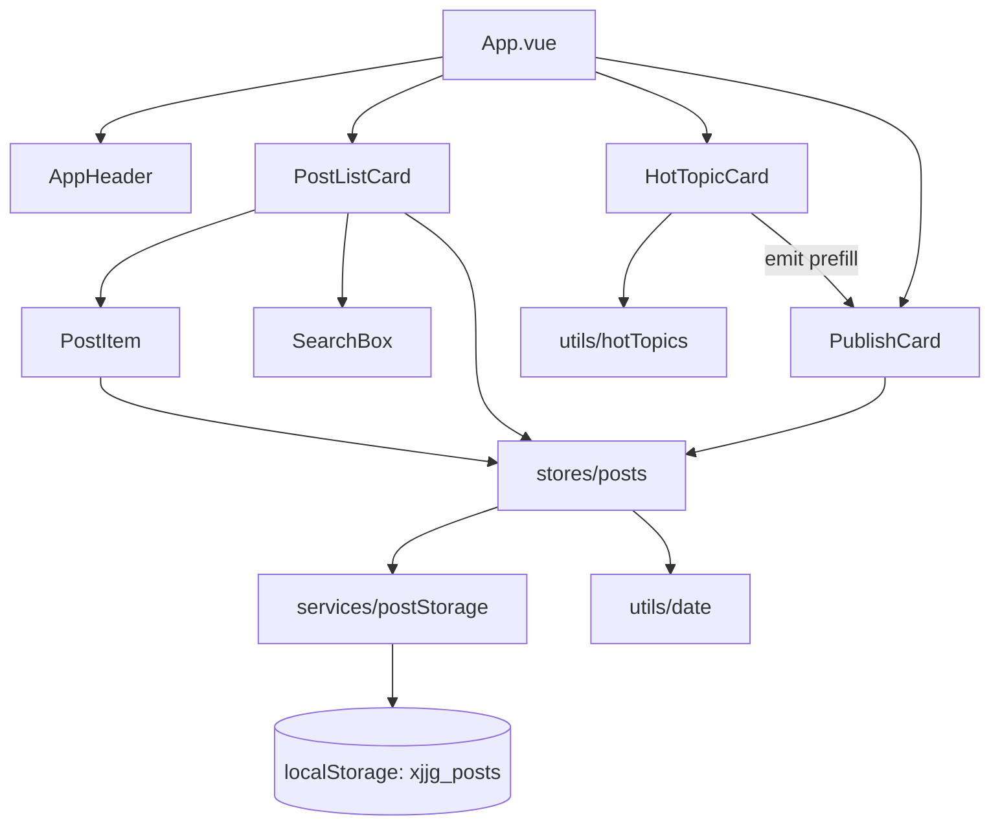

## 用户需求

把现有单文件「小晶推送馆」以 **TDD（测试先行）** 方式改写为 **Node.js + Vue 3 + Pinia** 工程，数据仍用 **Local Storage** 持久化，功能与视觉保持现状。

## 澄清结论

- 技术组合：Vite + JavaScript（Vue 3 + Pinia + Vitest），不使用 TypeScript。
- 旧版页面归档到 `legacy/index.html`，注明仅为历史参考。
- 测试范围：Vitest 单元测试（store / 工具函数 / 存储适配器）+ @vue/test-utils 组件测试，不做 Playwright E2E。
- 完成后提交并推送 GitHub（含本地未推送的 `2327d4f`）。

## 核心功能（改写后需完全保留）

- **今日热搜**：10 条内置热点（科技/社会/娱乐/体育/财经/教育/生活/文化），按日期种子生成热度并降序；排名徽章（前三渐变）、分类标签、热度条、热度数值；点击或 Enter 将标题预填到发布表单并滚动聚焦。
- **发布推送**：标题 ≤60 字、正文 ≤1000 字；三段校验提示（都空 / 缺标题 / 缺正文）；成功后置顶并提示。
- **我的推送**：按时间倒序展示标题、`YYYY-MM-DD HH:mm` 时间、正文、动作组（编辑 / 点赞 / 删除）。
- **搜索**：按标题+正文不区分大小写模糊匹配（输入防抖），计数「共 N 条 · 命中 M 条」，区分「还没有推送」与「没有匹配的推送」两种空态。
- **编辑**：回填表单、按钮切「保存修改」、出现「取消编辑」、条目左侧渐变标记；保存后更新原条目并保留点赞数。
- **点赞**：点赞/取消切换，计数为 0 时不显示数字。
- **删除**：二次确认后删除并同步存储。
- **持久化**：沿用键名 `xjjg_posts` 与字段 `{id,title,body,time,likes,liked}`，可读取旧版数据；存储不可用/写满时降级不崩溃并提示。

## 视觉与体验

沿用现有渐变玻璃拟态风格：淡紫蓝渐变背景、半透明磨砂卡片、渐变主按钮、圆角柔和投影、悬停/入场微动效；右栏「发布 + 我的推送」、左栏「今日热搜」两栏布局，≤860px 自动单列。本次为框架迁移，视觉不重构。

## 交付要求

- 体现 TDD：先提交失败测试（RED），再实现通过（GREEN），最后重构（REFACTOR）。
- `npm test` 全绿、`npm run build` 成功后可提交并推送。

## 技术栈

- 运行时：Node.js **v26.13.0**（fnm 安装，非默认 PATH）
- `C:\Users\86195\AppData\Roaming\fnm\node-versions\v26.13.0\installation\node.exe`
- 同目录 `npm.cmd`（npm 11.20.0）；执行前需 `$env:PATH = "C:\Users\86195\AppData\Roaming\fnm\node-versions\v26.13.0\installation;$env:PATH"`
- 构建：Vite（`@vitejs/plugin-vue`）
- 框架：Vue 3（Composition API + `<script setup>`，JavaScript）
- 状态：Pinia（setup store 写法）
- 测试：Vitest + @vue/test-utils + jsdom
- 样式：原生 CSS（沿用现有 CSS 变量与类名体系），组件内 `scoped`
- 存储：`localStorage`，键名 `xjjg_posts`（不引入 pinia-plugin-persistedstate，保持依赖最少、逻辑可测）

## 实现方案

### 分层设计（可测性是 TDD 的前提）

1. **纯函数层**（无 DOM、无 store）：`utils/date.js`（时间与日期文案格式化）、`utils/hotTopics.js`（由日期种子计算热度并排序）、`services/postStorage.js` 中的 `normalizePosts()`。
2. **存储适配层** `services/postStorage.js`：`readPosts()` / `writePosts(list)` / `isStorageAvailable()`，负责读写 `xjjg_posts`、脏数据归一化、异常降级（内存兜底 + 返回写入结果）。通过参数注入 `storage`（默认 `localStorage`），便于测试传入假对象模拟「不可用 / 抛 QuotaExceededError」。
3. **Store 层** `stores/posts.js`（Pinia setup store）：持有 `posts`、`keyword`、`editingId`、`lastError`；getters 语义通过 `computed` 暴露（`sortedPosts`、`filteredPosts`、`counts`、`editingPost`）；actions：`load()`、`publish({title,body})`、`startEdit(id)`、`updateEditing({title,body})`、`cancelEdit()`、`toggleLike(id)`、`remove(id)`、`setKeyword(kw)`，每次写操作后 `persist()` 由 store 内部调用，失败时设置 `lastError` 由 UI 以提示条展示。
4. **组件层**：`App.vue` 组装；`HotTopicCard`、`PublishCard`、`PostListCard`、`PostItem`、`SearchBox`、`AppHeader` 只做展示与事件派发，业务状态全部来自 store（避免组件内重复实现校验/过滤逻辑）。
5. **TDD 节奏**：每个模块先写 `*.spec.js`（明确断言：返回值、边界、错误分支、渲染文本/类名/事件），运行得到失败结果，再写最小实现使其通过，最后重构去重（例如把 store 与新组件共用的裁剪/校验逻辑抽到 `utils`）。

### 关键决策与取舍

- **为何不用持久化插件**：插件会隐藏「键名/归一化/降级」逻辑，难以单测；手写适配器 20 行左右即可覆盖旧数据兼容与异常场景，符合 YAGNI。
- **为何保留原生 CSS**：迁移目标是框架而非视觉，保留 `.card/.post/.hot-item` 等类名与变量，样式迁移成本低、回归风险小，也不引入 UI 库负担。
- **关键词防抖放组件层**（`SearchBox` 内 120ms debounce 后 emit），store 保持同步纯逻辑，测试无需 fake timers 即可断言；防抖本身用 `vi.useFakeTimers()` 单测。
- **刷新后持久化**：`App` 挂载时 `store.load()`；`load` 只读不写，避免与写回形成环。
- **性能**：列表规模为本地几十条量级；过滤/排序用 `computed` 缓存，O(n) 单次比较，不做虚拟列表；写回只在 mutation 后触发一次 `JSON.stringify`。
- **兼容性**：`normalizePosts` 补齐 `likes/liked`、截断超长 title/body、`time` 非法时用当前时间；`id` 保持 `Date.now()*1000 + seq` 单调唯一。

### 执行注意事项

- `node`/`npm` 不在 PATH：所有 npm 命令前先注入 fnm installation 目录，否则报「术语 'npm' 不会被识别」。
- 不用 `npm create vite` 交互式脚手架（易卡在交互与网络）；手写 `package.json` 后 `npm install vue pinia` + `npm install -D vite @vitejs/plugin-vue vitest @vue/test-utils jsdom`。
- npm registry 可能不可达（此前 github.com:443 曾超时）：安装失败要如实回报并给出 `npm config set registry https://registry.npmmirror.com` 方案，禁止伪造测试通过。
- Vitest 配置写在 `vite.config.js` 的 `test` 字段（`environment: 'jsdom'`、`globals: true`、`setupFiles: './tests/setup.js'`），`tests/setup.js` 中 `beforeEach` 清理 `localStorage` 与 `confirm` mock。
- 组件测试若依赖 `confirm()`，在用例内 `vi.spyOn(window,'confirm').mockReturnValue(true)`，避免 jsdom 未实现导致报错。
- 新增 `.gitignore`：`node_modules/`、`dist/`、`coverage/`、`*.local`；保留原有 `.playwright-cli/`、系统文件规则；不删除 `.codebuddy/`、`.agents/`。
- 旧文件用 `git mv index.html legacy/index.html` 保留历史；新 `index.html` 仅作 Vite 入口。
- 推送前确认 `build` 与 `test` 均通过；推送若失败（`Failed to connect to github.com:443`）如实反馈并给出重试命令。

## 架构设计



## 目录结构

```
lastday/
├── index.html                       # [MODIFY] Vite 入口：仅保留 #app 与 /src/main.js 脚本引用
├── legacy/
│   └── index.html                   # [MOVE] 由根 index.html git mv 而来，旧单文件版归档（顶部加注释说明仅历史参考）
├── package.json                     # [NEW] name/scripts(dev/build/preview/test/test:watch/coverage)/deps 与 devDeps
├── vite.config.js                   # [NEW] vue 插件 + test 配置（jsdom/globals/setupFiles/coverage）
├── .gitignore                       # [MODIFY] 追加 node_modules/、dist/、coverage/、*.local
├── README.md                        # [MODIFY] 改写为 Vue 工程说明：技术栈、脚本、测试策略、目录结构、xjjg_posts 兼容说明
├── src/
│   ├── main.js                      # [NEW] createApp(App).use(createPinia()).mount('#app')
│   ├── App.vue                      # [NEW] 页面骨架：banner + 两栏布局；onMounted 调用 store.load()；承载提示条与热搜→表单预填联动
│   ├── assets/
│   │   └── base.css                 # [NEW] 迁移原全局样式：CSS 变量、背景光斑、.card/.banner/.layout、动画关键帧、≤860px 单列（含 minmax(0,1fr) 修横向溢出）
│   ├── data/
│   │   └── hotTopics.js             # [NEW] HOT_TOPICS 常量（10 条 title+cat，与原版逐条一致）
│   ├── utils/
│   │   ├── date.js                  # [NEW] formatTime(ts) -> 'YYYY-MM-DD HH:mm'、formatDateChip(date) -> '2026 年 11 月 13 日 · 星期五'
│   │   └── hotTopics.js             # [NEW] buildHotList({ date, topics }) 纯函数：日种子热度 60+((seed+i*7)%23)，降序排序，返回 {title,cat,heat} 数组
│   ├── services/
│   │   └── postStorage.js           # [NEW] STORAGE_KEY='xjjg_posts'；isStorageAvailable(storage)；normalizePosts(list)；readPosts(storage)；writePosts(list, storage)。归一化字段类型与长度、补 likes/liked、脏数据过滤；写入异常返回 {ok:false} 且不抛出
│   ├── stores/
│   │   └── posts.js                 # [NEW] Pinia setup store：state(posts/keyword/editingId/lastError) + computed(sortedPosts/filteredPosts/counts/editingPost) + actions(load/publish/startEdit/updateEditing/cancelEdit/toggleLike/remove/setKeyword/persist)；publish/update 复用同一校验函数并返回 {ok,message}
│   ├── components/
│   │   ├── AppHeader.vue            # [NEW] 标题渐变文字 + 副标题 + 中文日期胶囊
│   │   ├── HotTopicCard.vue         # [NEW] 渲染 buildHotList 结果；条目 role="button" tabindex="0"，click/Enter 触发 prefill(title)；>前移动效与「去发布 ›」悬停提示
│   │   ├── PublishCard.vue          # [NEW] 标题/正文输入（maxlength 60/1000）+ 发布/保存修改按钮 + 取消编辑；暴露 prefill(title)、focusTitle()；展示校验与成功提示（2.6s 自动隐藏）
│   │   ├── PostListCard.vue         # [NEW] 头部搜索框与计数文案；列表渲染 PostItem；区分两种空态
│   │   ├── SearchBox.vue            # [NEW] v-model 语义 + 120ms 防抖 emit('update:modelValue')，聚焦主色描边
│   │   └── PostItem.vue             # [NEW] 单条展示：标题/时间/正文/动作按钮（编辑 ✎、点赞 ♥+计数、删除 ✕）、editing 时左侧渐变标记；emit edit/like/delete
└── tests/
    ├── setup.js                     # [NEW] beforeEach 清空 localStorage、重置 confirm mock；afterEach 清理 vi
    ├── unit/date.spec.js            # [NEW] 时间补零格式化、日期胶囊文案（含星期）
    ├── unit/hotTopics.spec.js       # [NEW] 10 条、热度范围 60~82、降序、同一日期结果稳定、不同日期热度不同
    ├── unit/postStorage.spec.js     # [NEW] 空存储返回 []、非法 JSON 返回 []、旧数据补 likes/liked、超长截断、storage 抛错时 readPosts 不崩且 writePosts 返回 ok:false
    ├── unit/postsStore.spec.js      # [NEW] 发布校验三种提示、发布置顶与落库、startEdit/updateEditing 保留 likes 且不新增、toggleLike 往返、remove 删除、setKeyword 过滤与命中计数、load 读取旧数据、写失败时 lastError
    └── components/
        ├── PublishCard.spec.js      # [NEW] 空提交显示错误、成功 emit、编辑态按钮文案与取消按钮、prefill 生效
        ├── PostListCard.spec.js     # [NEW] 两种空态、计数文案、搜索防抖触发过滤、删除二次确认（confirm true/false 两分支）
        ├── PostItem.spec.js         # [NEW] 点赞态类名与计数隐藏规则、编辑/删除事件携带 id
        └── HotTopicCard.spec.js     # [NEW] 渲染 10 条、点击与 Enter 均 emit prefill、前三名带排名样式类
```

## 关键接口（接口级约定）

```js
// services/postStorage.js
export const STORAGE_KEY = 'xjjg_posts'
export function normalizePosts(list)            // => Post[]
export function readPosts(storage = localStorage)              // => Post[]
export function writePosts(list, storage = localStorage)       // => { ok: boolean, error?: string }

// stores/posts.js（setup store 暴露）
// state: posts: Post[], keyword: string, editingId: number|null, lastError: string
// computed: sortedPosts, filteredPosts, counts { total, matched, isFiltering }, editingPost
// actions:
//   load(): void
//   publish({ title, body }): { ok: boolean, message: string }
//   startEdit(id): void
//   updateEditing({ title, body }): { ok: boolean, message: string }
//   cancelEdit(): void
//   toggleLike(id): void
//   remove(id): void
//   setKeyword(kw): void
```

## TDD 执行顺序

1. 写 `tests/unit/date.spec.js`、`hotTopics.spec.js` → 运行失败 → 实现 `utils` → 通过。
2. 写 `tests/unit/postStorage.spec.js`（含假 storage 抛错分支）→ 失败 → 实现 `services/postStorage.js` → 通过。
3. 写 `tests/unit/postsStore.spec.js` → 失败 → 实现 `stores/posts.js` → 通过。
4. 写组件 spec（PublishCard → PostItem → PostListCard → HotTopicCard）→ 逐个失败 → 实现组件 → 通过。
5. 组装 `App.vue` + `base.css`，跑全量 `npm test` 与 `npm run build`，用预览服务核对桌面/窄屏视觉与热搜→预填联动。

## Agent Extensions

### Skill

- **vue-best-practices**
- Purpose: 指导 Vue 3 工程骨架、`<script setup>` 组件结构、props/emit 与响应式写法
- Expected outcome: 组件遵循 Composition API 与单向数据流约定，无 Options API 混用与响应式误用
- **vue-testing-best-practices**
- Purpose: 指导 Vitest + @vue/test-utils 的测试组织、store 挂载、事件断言与 fake timers 用法
- Expected outcome: 单元/组件测试结构清晰、断言稳定，不依赖实现细节
- **vue-pinia-best-practices**
- Purpose: 指导 setup store 写法、mutation 粒度与 computed 派生状态设计
- Expected outcome: store 职责单一、可独立单测，组件不重复实现业务逻辑